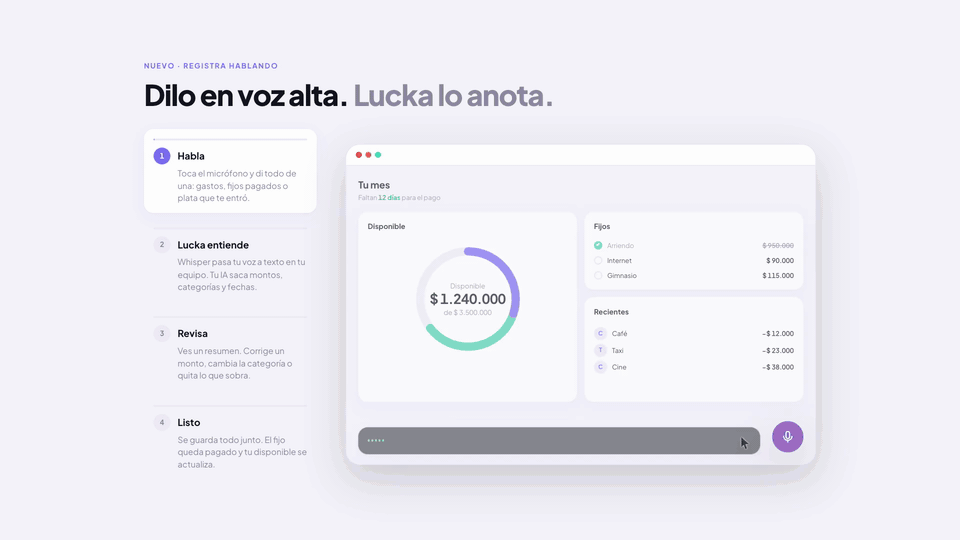

# Lucka · landing

Download page for [Lucka](https://github.com/juan-ramirez-dev/lucka), a local-first personal finance desktop app for macOS and Windows.

**Live:** [juan-ramirez-dev.github.io/lucka-landing](https://juan-ramirez-dev.github.io/lucka-landing/)

_Voice entry in four steps. [Full-quality MP4](assets/demo-voz.mp4) (1080p, 21 s)._

## What's on the page

- **Hero** with a live mock of the dashboard: expenses get registered and the ring updates.
- **Voice entry demo** (`#voice`): the app's real flow in 4 clickable steps, with pause.
  - Speak → Whisper transcribes on-device → AI extracts records → review → save.
- **Choose your AI:** Whisper always local; Qwen on-device or your own OpenAI / Anthropic / Gemini key.
- **Features**, customizable widgets, and first-launch steps for unsigned builds.
- Download button picks macOS or Windows from the user agent.

## Tech stack

| Layer     | Tech                                                 |
| --------- | ---------------------------------------------------- |
| Page      | Plain HTML, CSS and JS. No build, no dependencies    |
| Design    | Same tokens as the app (copy of `globals.css`)       |
| Hosting   | GitHub Pages, deployed by GitHub Actions on `main`   |
| Downloads | Fixed-name assets on the app's latest GitHub Release |

## Engineering highlights

- **Mocks, not screenshots.** The dashboard and voice demo are HTML, so they stay sharp at any size and change with a text edit.
- **Timeline as a pure function.** The voice demo is `render(t)`: pause, seek and step jumps just change `t`. CSS transitions do the smoothing.
- **Cheap when idle.** Animations only run while visible and the tab is active.
- **Accessible by default.** Reduced motion turns each step into a still frame. Without JS the page is complete. The mock is `aria-hidden`; the steps tell the same story as text.
- **Release-proof links.** `releases/latest/download/Lucka-macos.dmg` and `Lucka-windows-setup.exe` never change between versions.

## Project notes

- Colors: tokens in the `<style>` of `index.html`. `styles.css` only uses `var(--token)`.
- Voice demo timings live in `main.js`. If the flow changes in the app, update them there.
- The video was recorded from the page itself, frame by frame (headless Chrome + ffmpeg). If the demo changes, re-record `assets/demo-voz.mp4` and `assets/demo-voz.gif`.
- Pending screenshots: `assets/macos-warning.png`, `assets/windows-warning.png` → "First launch" section.

## Run locally

Open `index.html` in a browser.

## License

MIT
